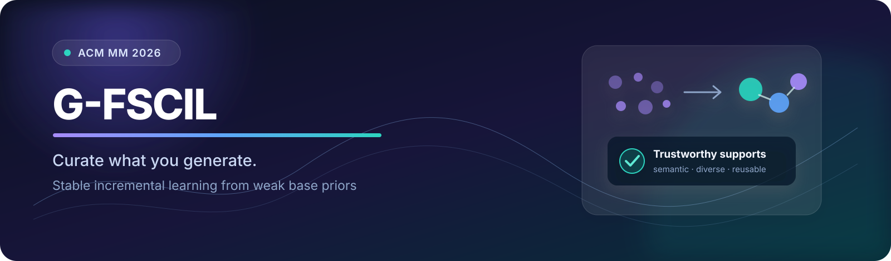

  

  <h1>Learning to Curate What You Generate</h1>
  <h3>Generalizable Few-Shot Class-Incremental Learning</h3>

  

    <strong>Junhui Yin*</strong> &nbsp;·&nbsp;
    <strong>Yuchen Yang*</strong> &nbsp;·&nbsp;
    Yilin Yin &nbsp;·&nbsp; Shuai Na &nbsp;·&nbsp; Haoran Xi 
    Jianhua Yang† &nbsp;·&nbsp; Muyi Sun &nbsp;·&nbsp; Man Zhang &nbsp;·&nbsp; Shengfeng He
  

  
* Equal contribution &nbsp;&nbsp; † Corresponding author

  

    
    
    
  

> [!IMPORTANT]
> This is the official project repository. Code, pretrained models, configuration files, and reproducible evaluation scripts are being organized and will be released soon.

## Overview

Few-shot class-incremental learning usually assumes that the base session contains enough classes to establish reliable category priors. We study the more challenging and realistic **Generalizable FSCIL (G-FSCIL)** setting, where both the base and incremental sessions are severely data-constrained.

Our framework learns to **curate trustworthy synthetic knowledge** instead of naively using every generated sample. It combines:

- **Reusable synthetic candidate pools** built with class inversion in a frozen latent diffusion model.
- **Transferable knowledge curation** that selects semantically consistent and visually diverse supports.
- **Synthetic-informed prototype initialization** for stable novel-class insertion.
- **Bidirectional boundary calibration** to reduce old-new class conflicts.

  

## Release Status

| Component | Status |
|:--|:--:|
| Training and evaluation code | 🛠️ Coming soon |
| Experiment configurations | 🛠️ Coming soon |
| Pretrained checkpoints | 🛠️ Coming soon |
| Synthetic pool construction | 🛠️ Coming soon |
| Reproduction instructions | 🛠️ Coming soon |

## Highlights

- Introduces **G-FSCIL**, where incremental learning begins from weak base priors.
- Turns noisy generation into reliable supervision through learned synthetic knowledge curation.
- Reuses a distilled selection policy in later sessions without re-optimizing the selector.
- Improves accuracy, reduces forgetting, and better balances old and new classes across CIFAR-100, CUB-200, and ImageNet-R.

## Citation

BibTeX will be added once the official publication record is available.

## Contact

For questions, please open an issue in this repository.

---

  If you find this project useful, please consider starring the repository to follow the release.

